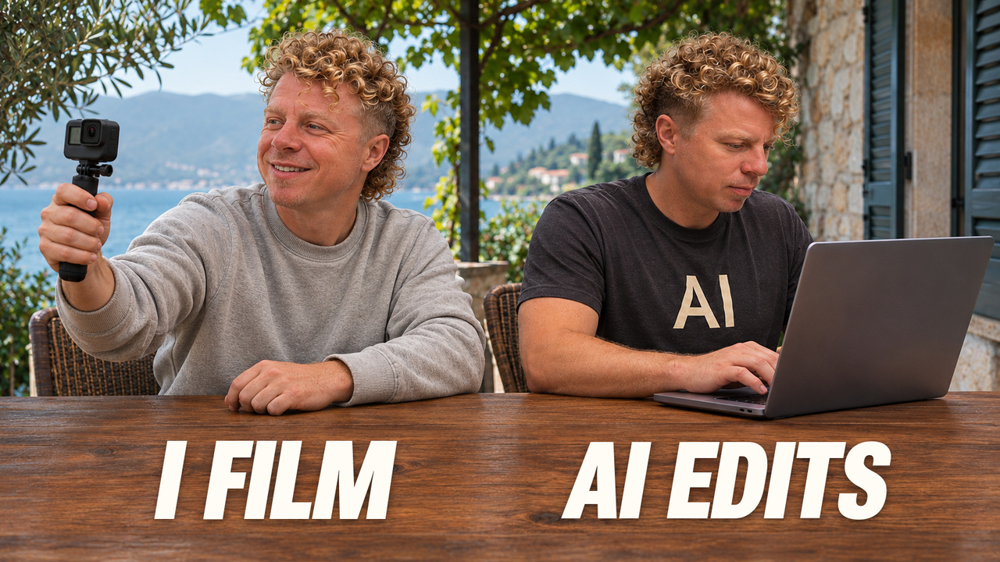
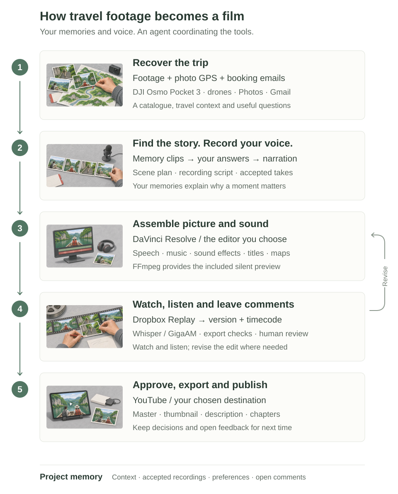

# Family Travel Editor

**A free AI skill for Claude Code and Codex that helps you turn travel footage into a film.** Organize your clips, recover the story behind them and work through edits with your agent. Use it with your video editor; it is not a standalone editing app.

[**Start with one scene**](#start-with-one-scene) · [Watch the overview](#watch-how-it-works) · [What’s New in v0.3.9](docs/whats-new-v0.3.9.md) · [Capabilities and limits](docs/capabilities.md)

## Watch how it works

<a href="https://www.youtube.com/watch?v=FP_AA2khgtM">
  
</a>

[**&#9654; Watch on YouTube**](https://www.youtube.com/watch?v=FP_AA2khgtM) &middot; 1:45 &middot; English


## Start with one scene

1. **[Download the v0.3.9 source ZIP](https://github.com/denyakortunov/family-travel-editor/releases/download/v0.3.9/family-travel-editor-source-v0.3.9.zip)** and unzip it. Open the extracted folder in your local AI agent.
2. Ask: **“Read `skills/family-travel-editor/SKILL.md`, check this installation and explain the next step.”** The agent needs file access and Python 3.9+ for the helper check. An editor and footage are optional for this first check.
3. Give it **your footage folder, a separate working folder and one scene you want to tell**. Name your editor, or say “undecided.” Expect a catalogue, a readable scene plan, open questions and a saved next step.

Downloading does not start an edit. Start a chat and give the agent a scene to work on. Inspecting picture and sound requires suitable tools; a file catalogue alone does not mean the footage has been watched.

[Installation, first prompt, returning tomorrow and troubleshooting](docs/getting-started.md)

<details>
<summary>Install permanently in Codex or another compatible agent</summary>

From the extracted repository root:

```sh
python3 tools/install_skill.py --destination ~/.agents/skills
```

Open a new chat and invoke `$family-travel-editor`, or use the absolute SKILL.md path printed by the installer. If you already use `~/.codex/skills`, update that location to avoid duplicate copies.

Alternatively, use the optional [skills CLI](https://github.com/vercel-labs/skills) and choose your agent when prompted:

```sh
npx skills add https://github.com/denyakortunov/family-travel-editor/tree/v0.3.9/skills/family-travel-editor
```

The CLI needs Node.js; the Python installer does not. See the [update and backup guide](docs/getting-started.md#6-update-or-undo-an-update).

</details>

## How it works

<picture>
  <source media="(max-width: 600px)" srcset="docs/workflow-mobile-illustrated.svg">
  
</picture>

[Explore each step and a worked story example](docs/from-footage-to-film.md)

Keep the scene plan, preferences and timecoded feedback in your film workspace. They give the next session a record of what was decided and what still needs work.

The included helpers catalogue files, render **silent video previews** and prepare **video-only Resolve XML**. Full sound mixing, titles and direct editor control need separately available tools. The bundled Resolve import/playback/export route remains unvalidated. For other editors, use the [manual assembly plan](docs/manual-assembly.md) unless you have a tested integration.

## Try a concrete example

- **[Grand Canyon picture edit](examples/grand-canyon-sunset/README.md):** three real source clips become 24 seconds, then a bounded revision makes it 22 seconds. Clips and both silent previews are included in the source ZIP.
- **[From memory to a scene plan](examples/memory-to-plan/README.md):** an author's answer becomes a provisional plan and a revision. This is a planning example without inspected footage or a finished film.
- **[Synthetic trimming exercise](examples/story-to-cut/README.md):** exact source ranges and a two-second trim for checking helper behavior.

## Why I made this

I film our family trips on a DJI Osmo Pocket 3 and drones. Editing a film usually takes me 20–30 hours, so footage can sit untouched for years. I built this skill to give an agent a repeatable process and keep useful decisions between sessions. It still takes editorial work; time savings have not been measured.

One useful question was why we went to the mountains. My answer: we wanted cooler weather than Singapore. That gives sweaters, tea and a fireplace a shared meaning. The next step is to find the actual shots that tell that story.

<details>
<summary>Tools and budget</summary>

### Tools and budget

The skill and helper scripts are free and open source. Your agent, editor and optional services have their own costs. Use the tools you already have; a paid editor is not required to start planning.

- Python runs the local helpers. FFmpeg and ffprobe are needed for the optional silent preview.
- Use your preferred editor. [Editor choices and integration limits](skills/family-travel-editor/references/editors.md) explain the supported routes.
- Photos, selected travel records and licensed music libraries are optional. Your own answers can supply travel context.
- For sound work, see [Fairlight mix checks](skills/family-travel-editor/references/fairlight.md), [music and sound timing](skills/family-travel-editor/references/scene-music.md) and the [optional Epidemic Sound guide](skills/family-travel-editor/references/epidemic-sound.md).

</details>

## Data and help

The bundled Python helpers run locally without network calls. Your agent and connected tools may send material to their providers according to your setup. Keep private footage, credentials and travel records out of public issues.

[Tell us where you got stuck](https://github.com/denyakortunov/family-travel-editor/issues/new/choose), including the skill version, agent/editor and confusing step. [Contributing](CONTRIBUTING.md) · [Validation](docs/validation.md) · [Roadmap](docs/roadmap.md) · [Release history](docs/release-notes.md).

Original code and instructions: [MIT](LICENSE). [Third-party notices](THIRD_PARTY_NOTICES.md). Independent project by [Denis Kortunov](https://github.com/denyakortunov).
