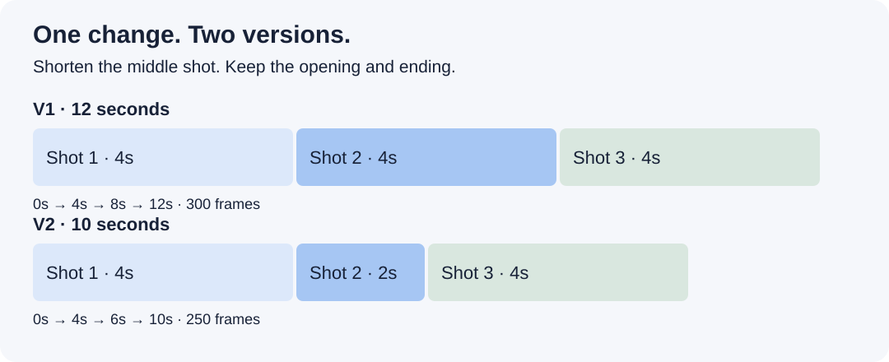

# AI Travel Video Editor

**Turn a folder of travel clips into a scene plan, a first cut and a clear next revision—with an AI agent and your creative direction.**

[**Try it with one scene →**](#start-with-one-scene) · [See a working example](docs/walkthrough.md) · [Choose your editor](skills/family-travel-editor/references/editors.md)


Camera clips. Drone shots. Half-remembered moments. This skill gives your agent a process for finding the story, choosing source ranges and turning your feedback into the next version. Start with a manageable scene instead of trying to solve the entire trip at once.

**Free, open-source instructions and helper scripts.** Use Codex or a compatible local agent. You do not need to buy Resolve to plan a scene or render the included silent preview; your chosen agent or external services may have their own fees.

## What you get

- **A clearer story:** a footage catalogue, useful questions and a scene plan you can review before editing.
- **A concrete first cut:** selected source ranges and a simple FFmpeg video preview, or timeline preparation for supported tools.
- **Revisions you can follow:** version + timecode + request, a bounded change and a check of the exported result.
- **Context you can keep:** scene decisions and explicit preferences stored in your project for the next session.

The agent helps with the work. You decide which moments matter, confirm memories and judge the finished scene.

## See one edit from start to finish

**Three test clips. One correction. Two comparable results.**

The first preview is 12 seconds. Ask to shorten the middle shot by two seconds while preserving the opening and ending. The revised preview is 10 seconds.



[**Open the illustrated walkthrough →**](docs/walkthrough.md) · [V1 video: 12 seconds](examples/first-scene/generated/v1.mp4) · [V2 video: 10 seconds](examples/first-scene/generated/v2.mp4)

The walkthrough includes actual frames from the test clips, a suggested agent prompt, exact shot ranges, the feedback record and reproduction commands. It demonstrates timing and preservation using synthetic clips, with no people, speech or music. It does not claim to reproduce a finished travel film.

Prefer a browser view? After downloading the repository, open [docs/walkthrough.html](docs/walkthrough.html) for the same steps with two video players. GitHub displays the HTML source; the illustrated Markdown guide above works directly on GitHub.

## Start with one scene

### 1. Download and open

[**Download the latest source ZIP**](https://github.com/denyakortunov/family-travel-editor/archive/refs/heads/main.zip), unzip it and open the folder in a local agent that can read files and run commands. Keep your footage in a separate folder. Python 3.9+ supports the basic catalogue; FFmpeg and ffprobe are needed for the preview.

### 2. Give your agent this starting task

Fill in the footage folder and your editor, or leave the editor undecided:

> Read `skills/family-travel-editor/SKILL.md`. My footage is in [folder] and I use [editor, or undecided]. Start with one short scene. Check the available tools, create a separate planning workspace, catalogue the clips and ask me only the questions that change the story. Give me a scene plan with confirmed facts and open questions before editing. Preserve my originals. If you cannot view or hear the material, say so. Do not require Resolve or paid services for planning.

### 3. Review the plan, then build the cut

Expect a catalogue (`catalog.json`), a scene plan (`scene.json`) and a status note describing the next step. Review the story before the agent derives the frame-based shot plan. The file catalogue is technical evidence, not proof that every clip was watched.

**No footage ready? Start with the included test instead:**

> Read the skill and `examples/story-to-cut/README.md`. Use the included synthetic clips in a new temporary folder. Show me the 12-second preview, apply the sample feedback and show the 10-second version. Explain what changed and what stayed intact. Do not open Resolve.

[Exact demo commands](examples/first-scene/README.md) · [Filled scene and feedback example](examples/story-to-cut/README.md)

<details>
<summary><strong>Install the skill in Codex for future projects</strong></summary>

From the repository root:

```sh
python3 tools/install_skill.py --destination ~/.codex/skills
```

Start a fresh chat and invoke `$family-travel-editor`. For updates, add `--update`; the installer keeps a dated backup. Store film memory in your project, outside the installed skill. Other agents can use their own skill folder or read `SKILL.md` directly. [Setup and troubleshooting](skills/family-travel-editor/references/setup.md).

</details>

## Fit it to the tools you already use

The workflow separates story decisions from editor-specific operations. Optional tools can supply metadata, transcripts, review comments or an editable timeline.

| Your setup | What you can do now |
|---|---|
| Local agent + Python | Catalogue files, work through questions, plan scenes and record feedback |
| Add FFmpeg + ffprobe | Render a silent, straight-cut preview from same-rate 24/25/30 fps clips |
| DaVinci Resolve | Generate video-only FCP 7 XML; guarded Studio import helper included, native round trip still unvalidated |
| Shotcut (experimental) | Picture-only MLT generator on this branch; native MLT tests pass, desktop open/edit/save verification is still pending. [Adapter guide](skills/family-travel-editor/references/shotcut.md) |\n| iMovie, CapCut or another editor | Use the story, shot list and feedback; assemble manually or supply a separately tested adapter |
| Photos, email or travel notes | Optionally reconstruct context from selected evidence; answering the agent's questions is enough to start |
| Replay or another review tool | Give versioned timecode comments; plain text works too |

[Editor guide and integration limits](skills/family-travel-editor/references/editors.md) · [Full optional-tool diagram](docs/workflow.png)

Whisper, GigaAM, Gemini and an optional Claude audit are examples of tools used in the broader workflow. They are not bundled accounts or required subscriptions. Record what a tool actually checked and what still needs human review.

## Know what is included

This is an **Agent Skill**, not a standalone video editor. The included renderer makes silent previews. It does not automatically mix dialogue and music, add titles, operate every editor or publish a full film. The skill provides guidance for those stages; execution requires appropriate tools and verification.

[Validation and known limits](docs/validation.md) · [Roadmap](docs/roadmap.md) · [Release notes](docs/release-notes.md)

## Try it, then help improve it

Start with one scene. If something breaks, [report the editor, exact command and observed result](https://github.com/denyakortunov/family-travel-editor/issues/new/choose). If you build an adapter, include a tiny reproducible example and evidence of import, playback and export. [Contribution guide](CONTRIBUTING.md).

To resume a project, ask your agent to read its status, scene plan, preferences and open feedback before continuing the named version.

Original code and instructions: [MIT](LICENSE). Synthetic example media is included for testing. [Third-party notices](THIRD_PARTY_NOTICES.md). Independent project; not affiliated with the editors or services shown.

Created by [Denis Kortunov](https://github.com/denyakortunov).
