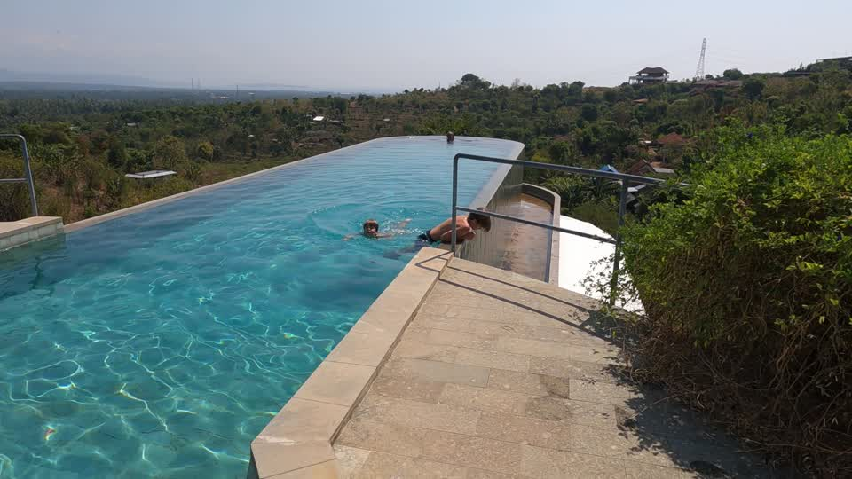

# AI Travel Video Editor

**Turn camera and drone footage into a family film with an AI agent: organize clips, reconstruct the story, draft voiceover and learn from timecoded feedback.**

[Start with one scene](#start-with-one-scene) · [Real film & story](docs/real-film.md) · [Choose your editor](skills/family-travel-editor/references/editors.md) · [Validation](docs/validation.md)

I travel with my family and shoot on a DJI Osmo Pocket 3 and drones. Editing a trip usually takes me 20–30 hours. Working with an agent has not yet demonstrated a time saving. What it gives me is a way to retain the work: the questions we answered, the cuts we corrected and the preferences I would otherwise have to explain again.

Family Travel Editor packages that process as an Agent Skill for Codex and compatible local agents. A skill is a folder of instructions and small helper scripts that your agent reads. It is not a standalone editor or a one-click film generator. **You do not need to buy DaVinci Resolve to plan a film or try the included video-only preview.** The storytelling workflow is editor-independent; automated timeline operations depend on the chosen editor and adapter.

## See the real workflow

[](https://www.youtube.com/watch?v=hzqUOtD2AqU&t=641s)

[Watch the published Bali film](https://www.youtube.com/watch?v=hzqUOtD2AqU) · [Read the case study and specific revisions](docs/real-film.md)

This film came from the larger personal workflow that inspired the skill. It is **not** a film generated end-to-end by this public starter package. The linked footage is public; personal source media, email records and project databases are not included.


The diagram shows my own tools. Resolve, Photos, Gmail, Replay, Claude, Gemini and other audio models are examples, not required subscriptions or bundled connections. Replace a service with another tool that can supply the same evidence: metadata, a transcript, a review comment or an editable timeline.

## What works today

| Task | Included here | What you supply |
|---|---|---|
| Catalogue footage | Local file hashes and optional ffprobe metadata | Footage; a local agent to view and interpret it |
| Find the story | Scene template, questions, editorial guidance | Your memories; optional selected photo GPS or travel records |
| Voiceover and review | Writing guidance, versioned feedback and preference examples | Your recording and listening; optional transcription tools |
| Produce a simple preview | FFmpeg renderer from a shot plan | FFmpeg + ffprobe; same-rate 24/25/30 fps clips; **video only** |
| Prepare a Resolve timeline | FCP 7 XML generator and guarded import helper | Manual import, or working Studio scripting for the bridge; native import still unvalidated |
| Use iMovie, CapCut or another editor | Portable story, shot list, voiceover and feedback | Manual assembly or a separately tested adapter; no native adapter bundled |
| Publish a film | Delivery checklist | Your account, review and explicit publishing instruction |

The helpers do not automatically conform dialogue, mix music, build titles or publish to YouTube. An agent can use other available tools for those tasks, but should say what it actually verified. [Editor options and automation boundaries](skills/family-travel-editor/references/editors.md).

## Start with one scene

1. [Download the current source](https://github.com/denyakortunov/family-travel-editor/archive/refs/heads/main.zip), unzip it and open the folder in a local agent that can read files and run commands. Python 3.9+ is enough for planning and the basic catalogue. Keep your footage in a separate folder.
2. Paste this prompt, filling in your footage folder and preferred editor. You can also ask the agent to help locate your footage.

> Read `skills/family-travel-editor/SKILL.md`. My footage is in [folder] and I use [editor, or undecided]. Start with one short scene. Check the available tools, create a separate planning workspace, catalogue the clips and ask me only the questions that change the story. Give me a scene plan with confirmed facts and open questions before editing. Preserve my originals. If you cannot view or hear the material, say so. Do not require Resolve or paid services for planning.

3. Expect `catalog.json`, a filled `scene.json`, and `STATUS.md` explaining the next step. The catalogue is technical metadata, not proof the clips were watched. Review the story before the agent derives a frame-based `shot-plan-v1.json`. See the [filled example](examples/story-to-cut/README.md) for the difference.

**No footage ready?** Ask the agent: “Read the skill and `examples/story-to-cut/README.md`. Use the included synthetic clips to generate a video-only preview in a new temporary folder. Show me the 12-second version, apply the sample feedback and show the 10-second version. Do not open Resolve.” This exercises the mechanics without uploading private material. [Exact commands](examples/first-scene/README.md).

To make the skill discoverable in Codex, run the installer once, then start a fresh chat:

```sh
python3 tools/install_skill.py --destination ~/.codex/skills
```

Invoke `$family-travel-editor`. Other clients can use their own skill directory or read `SKILL.md` directly. For updates, `--update` retains a dated backup of the old installed skill. Keep film memory outside the installation. [Setup and troubleshooting](skills/family-travel-editor/references/setup.md).

## Pick tools you already have

The required foundation is a local agent with media/file access, your footage and your judgement. Account fees and model usage depend on the tools you choose; this repository charges nothing and includes no service credits.

For a free command-driven preview, use the bundled FFmpeg path. For a future editable open-source integration, Shotcut/MLT is a promising starting point; Kdenlive and libopenshot also expose useful building blocks. These are **integration candidates, not tested adapters in this release**. iMovie and CapCut users can already use the planning and review workflow while assembling the timeline in their editor. [Comparison and official sources](skills/family-travel-editor/references/editors.md).

Without Photos or email, answer the agent's questions. Without Replay, send version + timecode + comment. Without a second model, use technical measurements and human review. Switching tools must preserve the story decisions, source ranges, feedback and previous versions; it does not guarantee project-format compatibility.

## Resume, report a problem, contribute

Keep your scene plans, personal memories and preferences in the film workspace, not the installed skill. To resume: “Read my workspace's STATUS, scene plan, preferences and open feedback. Continue the named version; tell me what remains unverified.” [Filled feedback and memory](examples/story-to-cut/README.md).

[Report a reproducible problem](https://github.com/denyakortunov/family-travel-editor/issues/new/choose), or contribute an editor adapter with a tiny example and evidence of import, playback and export. See the [roadmap](docs/roadmap.md) and [contribution guide](CONTRIBUTING.md). The highest-value next step is a reproducible native editor round trip, not another service integration badge.

## Documentation and license

The primary documentation is English. [Russian overview](README.ru.md).

Original code and instructions: [MIT](LICENSE). Synthetic example media is included for testing. The real-film still and linked family video are illustrative examples, **not covered by the code license**; see [third-party and media notices](THIRD_PARTY_NOTICES.md). Independent project; not affiliated with the editors or services shown.

Created by [Denis Kortunov](https://github.com/denyakortunov).
