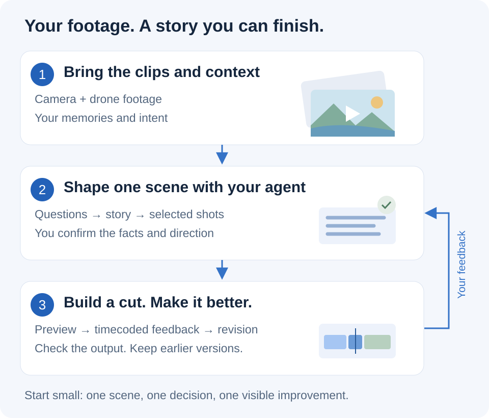

# Family Travel Editor

**An AI skill for Claude Code and Codex, used with your video editor.** It is not a standalone editor. It provides instructions, examples and helper tools for organizing footage, planning scenes and working through revisions. You use it in a local AI agent; you assemble the film in your preferred video editor. Direct editing by the agent requires an available, tested integration.

[**Start here →**](#start-with-one-scene) · [What’s New in v0.3.8](docs/whats-new-v0.3.8.md) · [Capabilities and limits](docs/capabilities.md) · [Real-footage example](examples/grand-canyon-sunset/README.md)

<picture>
  <source media="(max-width: 600px)" srcset="docs/workflow-mobile.svg">
  
</picture>

[Explore each step and a worked story example →](docs/from-footage-to-film.md)

## Start with one scene

1. **[Download the v0.3.8 source ZIP](https://github.com/denyakortunov/family-travel-editor/releases/download/v0.3.8/family-travel-editor-source-v0.3.8.zip)** and unzip it. Open the extracted folder in your local AI agent.
2. Ask: **“Read `skills/family-travel-editor/SKILL.md`, check this installation and explain the next step.”** The agent needs file access. The helper check needs Python 3.9+; no editor, footage or paid service is required for that check.
3. Give the agent **your footage folder, a separate working folder and one scene you want to tell**. Name your editor, or say “undecided.” Expect a catalogue, a readable scene plan, open questions and a saved next step. A catalogue is not proof that the clips have been watched.

Installing or downloading does not start an edit. Text-only planning can begin with your description; inspecting footage requires appropriate agent tools. ffprobe adds technical media metadata; ffmpeg is needed for the optional **silent** preview. Agent services may have their own charges.

[**Installation, first prompt, expected files, returning tomorrow and troubleshooting →**](docs/getting-started.md)

<details>
<summary>Install permanently in Codex or another compatible agent</summary>

From the extracted repository root, for current Codex versions:

```sh
python3 tools/install_skill.py --destination ~/.agents/skills
```

Open a new chat and invoke `$family-travel-editor`, or ask the agent to read the absolute SKILL.md path printed by the installer. Existing `~/.codex/skills` users should update their existing location to avoid duplicates.

An alternative for other compatible agents is the optional [skills CLI](https://github.com/vercel-labs/skills):

```sh
npx skills add https://github.com/denyakortunov/family-travel-editor/tree/v0.3.8/skills/family-travel-editor
```

Choose your agent when prompted. This route needs Node.js; the Python installer does not. See the [guide](docs/getting-started.md) for updates with backups and the [test record](docs/validation.md) for what has actually been checked.

</details>

## What you get

| Step | Useful result | Where it happens |
|---|---|---|
| Organize | Catalogue of files, hashes, metadata and problems | Local helper; no content understanding claimed |
| Shape the story | Scene outline grounded in viewed material and confirmed memories | Agent with available tools and your answers |
| Prepare assembly | Source ranges, shot roles, speech/music intentions and open questions | Readable plan; [manual assembly example](docs/manual-assembly.md) |
| Edit and review | A versioned edit, bounded corrections and preserved decisions | Your editor; automation depends on a tested integration |
| Continue later | Status, preferences and versioned feedback | Your separate film workspace |

Bundled automation currently provides a **silent video preview** and **video-only XML preparation**. Full audio mixing, titles and native editor control are not supplied as an end-to-end workflow. Resolve import/playback/export remains unvalidated. [Detailed capabilities →](docs/capabilities.md)

## See what the workflow looks like

Run the [real Grand Canyon footage example](examples/grand-canyon-sunset/README.md): three clips become a 24-second picture edit, then one bounded revision makes it 22 seconds. Source clips and both previews are included in the source ZIP. **Both previews are silent**; no native editor or audio mixing is claimed.

Without footage, start with the [recorded memory-to-plan session](examples/memory-to-plan/README.md): a real public author answer becomes a provisional scene plan, followed by a revision. It contains **no inspected travel footage or finished film**. The [synthetic assembly exercise](examples/story-to-cut/README.md) separately demonstrates exact source ranges and a two-second trim.

The full method is: **material and memories → story → picture, voices and music in your editor → timecoded review → a saved next step**. Optional photos and selected booking emails can help reconstruct context. They are not required, and a booking does not prove the journey happened. [Full workflow and mountain-trip example →](docs/from-footage-to-film.md)

## Why I made this

I film our family trips on a DJI Osmo Pocket 3 and drones. Editing a film usually takes me 20–30 hours, so footage can sit untouched for years. I built this skill to give an agent a repeatable process and keep useful decisions between sessions. It still takes work; I am not claiming a one-click film or a proven time saving.

One useful question was why we went to the mountains. My answer: we wanted cooler weather than Singapore. That gives sweaters, tea and a fireplace a shared meaning. The agent still needs to find and inspect actual shots; a memory is a starting point, not an invented image or timestamp.

<details>
<summary>Tools, cost and alternatives</summary>

### Tools and budget

The skill and its helper scripts are **free and open source**. A paid Resolve license is not required to start. Use the services you already have; the agent and any cloud models may have their own charges.

| Job | Example tool | Cost / practical alternative |
|---|---|---|
| Organize the workflow | Codex or another compatible local agent | Agent plan/API charges depend on your setup; skill files are free |
| Catalogue and render a test preview | Python + [FFmpeg](https://ffmpeg.org/legal.html) | **Free / open source**; preview helper included |
| Recover places and travel context | Apple Photos, Gmail | Optional existing accounts or selected exports; your answers also work |
| Edit a film | [DaVinci Resolve](https://www.blackmagicdesign.com/products/davinciresolve) | **Free edition available; Studio paid.** My external scripting setup targets Studio |
| Use an open-source editor | [Shotcut](https://www.shotcut.org/) / [Kdenlive](https://kdenlive.org/about/) | **Free / open source.** Plans work now; native adapters need separate validation |
| Use an editor you know | [iMovie](https://apps.apple.com/us/app/imovie/id408981434) / CapCut | iMovie is **free on supported Apple devices**; CapCut features/plans vary. Manual assembly in this package |
| Record narration | Your microphone + [Audacity](https://www.audacityteam.org/) or an existing recorder | Audacity is **free / open source**; no specific microphone required |
| Transcribe speech locally | [Whisper](https://github.com/openai/whisper) | **Open source**; local hardware required. Hosted transcription may charge |
| Review with timecoded comments | [Dropbox Replay](https://help.dropbox.com/create-upload/dropbox-replay-faq) | **Limited access included with Dropbox plans**; paid options. A text feedback file is free |
| Get a second opinion | Human review, optional editorial reviewers | **Optional**; access and charges vary. Human review remains essential |

Cost categories checked against linked product sources on 27 October 2026; limits and plans can change. Tools are optional examples, not accounts or subscriptions bundled with the skill. [Editor capabilities and integration limits](skills/family-travel-editor/references/editors.md).

</details>

## Data, help and contributing

The bundled Python helpers run locally without network calls. Your agent may send prompts, images or audio to its provider or connected tools according to your configuration; local helpers do not make every operation local. Use only the sources you choose to share. No private account connection is required.

[Ask a question or describe where you got stuck](https://github.com/denyakortunov/family-travel-editor/issues/new/choose). Include the skill version, agent/editor and the step that confused you; private footage is not required. [Contributing](CONTRIBUTING.md) · [Validation](docs/validation.md) · [Roadmap](docs/roadmap.md) · [Release history](docs/release-notes.md).

The [color-bar fixture](examples/first-scene/README.md) is a technical render test, not a sample travel film. Earlier provider-specific diagrams are retained as [historical material](docs/workflow.png); they do not describe required tools today.

Original code and instructions: [MIT](LICENSE). [Third-party notices](THIRD_PARTY_NOTICES.md). Independent project, not affiliated with the editors or services mentioned. Created by [Denis Kortunov](https://github.com/denyakortunov).
