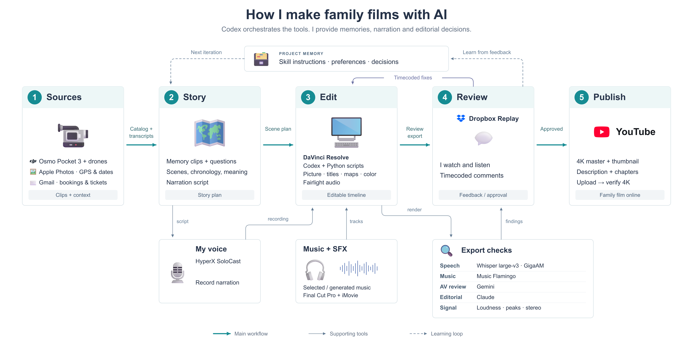

# Travel Video Editor for DaVinci Resolve

**An AI video editing skill for travel videos and family films in DaVinci Resolve.**

[Русская версия](README.ru.md) · [Quick start](#quick-start) · [Synthetic example](examples/first-scene/README.md) · [Validation](docs/validation.md)

I travel with my family and shoot on a DJI Osmo Pocket 3 and drones. Editing a trip usually takes me 20–30 hours. Working with an agent has not yet demonstrated a time saving, but it gives me a way to turn repeated decisions into a reusable process: reconstruct the story, ask about the memories, build a scene, review it and keep what we learned.

Family Travel Editor shares that process as an Agent Skill for Codex and compatible local agents, with local helpers and an experimental desktop plugin package. Use it to organize camera and drone footage, plan a travel story, draft voiceover and turn timecoded feedback into edits.



*The diagram describes the originating workflow. Named services and audio models are optional examples, not bundled integrations or mandatory subscriptions.*

## What it helps you do

- Reconstruct a trip from footage, chosen photo metadata, travel records and your memories.
- Plan coherent scenes, preserve complete dialogue and draft personal voiceover.
- Edit versioned timelines in Resolve with clear boundaries around each change.
- Check actual exports, apply timecoded feedback and maintain project preferences.

**v0.1.0 is experimental.** It is a workflow for a human and an agent, not a one-click film generator. The bundled XML helper produces same-rate, video-only straight cuts at integer 24/25/30 fps. It does not conform dialogue, mix music or build titles. The skill guides those tasks through the editor and available tools.

## Quick start

Clone the repository and open it in your local agent:

```sh
git clone https://github.com/denyakortunov/family-travel-editor.git
cd family-travel-editor
python3 skills/family-travel-editor/scripts/project.py doctor
```

Use this first prompt; explicit file access works without a global installation:

> Read `skills/family-travel-editor/SKILL.md`. My footage is in [your folder]. Help me choose and plan one scene. Ask about memories where they matter. Keep originals unchanged and tell me which tools are available before editing.

For Codex skill discovery, copy it into your configured skills directory. This installer refuses to replace an existing skill:

```sh
python3 tools/install_skill.py --destination ~/.codex/skills
```

Start a fresh chat and invoke `$family-travel-editor`. Clients with a different skill search path can pass that directory instead. Desktop plugin installation and public-directory review are separate; this repository does not claim an approved ChatGPT listing.

Create a planning workspace outside your source media:

```sh
python3 skills/family-travel-editor/scripts/project.py init ../my-film-workspace
python3 skills/family-travel-editor/scripts/project.py catalog /path/to/footage --output ../my-film-workspace/catalog.json
```

The catalogue records identity and optional technical metadata. It does not replace watching footage or listening to it.

## Requirements and optional tools

| Component | Needed for |
|---|---|
| A local agent with file/command access | Running the workflow on your media |
| Python 3.9+ | Bundled helpers; standard library only |
| DaVinci Resolve Studio and local scripting | Native editing; macOS is the first target environment |
| FFmpeg | Synthetic demo generation and export measurement |
| ffprobe | Rich source metadata; catalogue hashing also works without it |
| Photo metadata / selected email records | Optional trip context; questions are the fallback |
| Replay | Optional review; versioned timecoded text comments also work |
| Audio models and cloud services | Optional additional analysis; configure separately |

The helpers and synthetic exports have been tested. **Live Resolve import was unavailable during release preparation and is not validated.** See [exact coverage](docs/validation.md) before relying on the interchange helper. Other editors, operating systems and automatic skill discovery across all client versions are not certified.

## Try the technical example

[The included example](examples/first-scene/README.md) uses generated test-pattern footage, not a real family trip. It demonstrates explicit source ranges and a review change from 12 to 10 seconds. You can reproduce the clips, preview exports and regenerate a local XML timeline. It does not demonstrate speech analysis or artistic quality.

## Project memory stays with your film

The installed skill contains general instructions. Your source paths, personal memories, preferences, comments and delivery records belong in your separate film workspace. The package does not access email, publish videos, install models or upload media on its own.

## Contributing and reporting problems

Open an [issue](https://github.com/denyakortunov/family-travel-editor/issues) with the command, tool versions, expected result and a small reproducible example. Remove private media paths and personal context. For Resolve reports, distinguish XML generation, import, playback and export. Please keep changes focused and include a behavioural test for helper fixes.

## License

Original code and instructions: [MIT](LICENSE). Included example media is synthetic. Diagram assets have separate [third-party notices](THIRD_PARTY_NOTICES.md). Resolve and optional services/models are not included.

Independent project; not affiliated with Blackmagic Design.

Created by [Denis Kortunov](https://github.com/denyakortunov).
