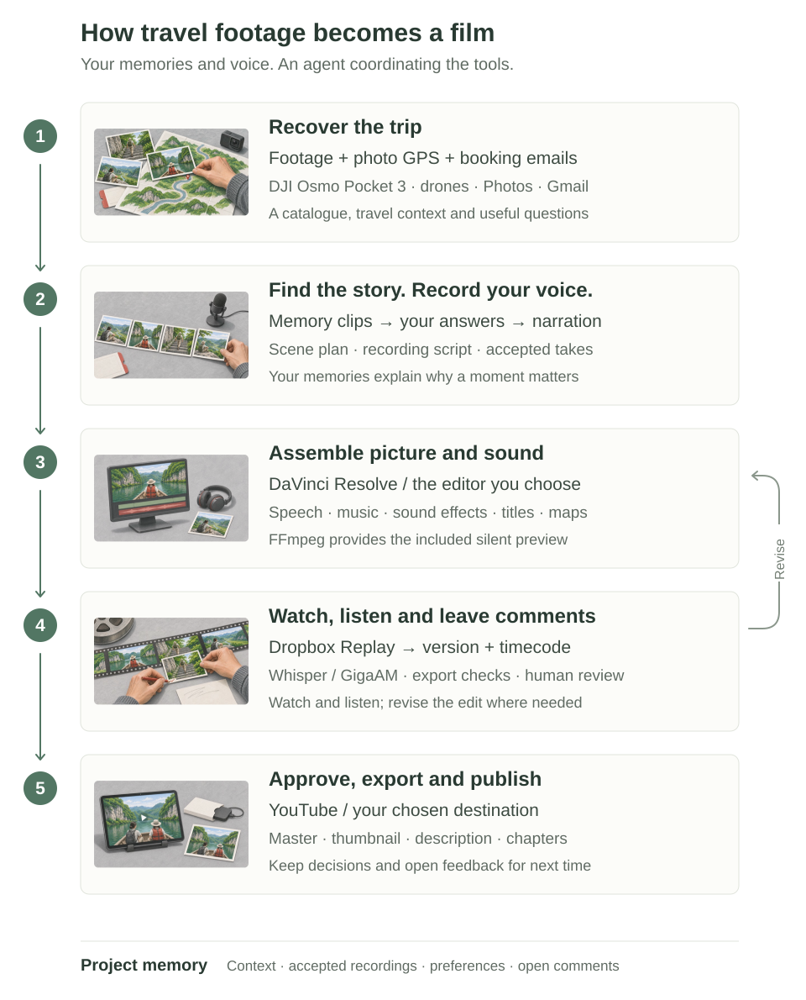
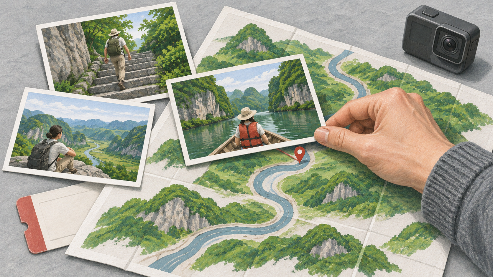
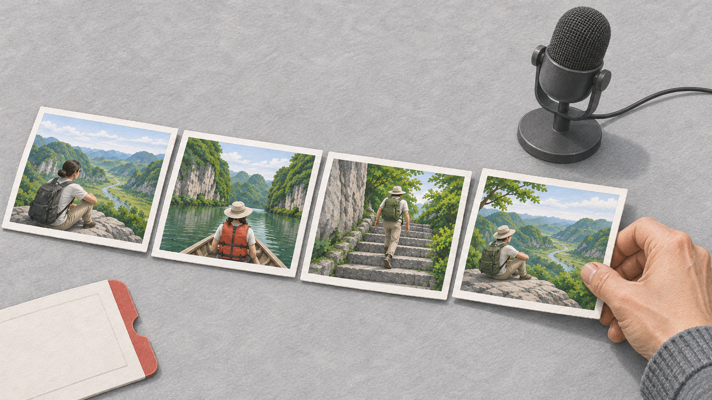
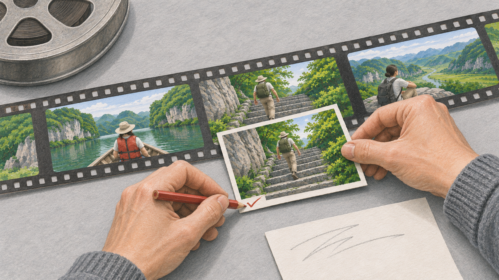

# From a folder of travel clips to a film with a story

Family Travel Editor helps an agent work through the footage, recover the story with you, and keep track of edits. The guide below explains the full method. The [capabilities page](capabilities.md) distinguishes it from what the bundled helpers can automate.

[Watch the English overview](https://www.youtube.com/watch?v=FP_AA2khgtM) · [Start with one scene](../README.md#start-with-one-scene) · [Tools and costs](../README.md#tools-and-budget) · [Reproducible trimming test](walkthrough.md)

The new illustrations use physical metaphors from the film. They are AI-generated illustrations, not source footage or records of a real trip.

<picture>
  <source media="(max-width: 600px)" srcset="workflow-mobile-illustrated.svg">
  
</picture>

## 1. Footage and travel evidence → a context ledger

*Match a moment to its place before deciding where it belongs in the story.*

Start with camera and drone originals. Catalogue paths, duration, frame rate and available dates, then inspect the picture and sound. A file inventory does not establish viewing coverage. Transcripts help locate speech; the action and its meaning need their own review.

Use **Apple Photos** for a specific purpose: GPS, dates and neighboring pictures can identify a location or put a sequence in context. Use **selected email messages** for another: hotel reservations, tickets and transfer arrangements can reconstruct the intended route. Keep these sources separate from what the video shows and what the author remembers. A camera clock can be wrong, and a reservation can go unused.

| Evidence | Question it can help answer | What to keep with it |
|---|---|---|
| Camera or drone clip | What is visible or audible? | File, source range, inspection coverage |
| Photo GPS and date | Where might this have been? | Selected photo reference, uncertainty |
| Booking or ticket | What travel was planned? | Relevant extracted fact, conflict with actual events |
| Author's answer | Why did this matter to us? | Confirmed wording, open questions |

**Handoff:** catalogue + context ledger + a short list of useful questions. Accounts are optional: selected exports, travel notes and the author's answers can do the same job. Keep private evidence in the film workspace, not in a public repository.

## 2. Memory clips and questions → a story and a recording script

*Choose the moments that belong together, then record the memories the pictures cannot explain.*

Show short selections that jog the author's memory. Ask questions tied to a visible moment: what were you trying to do, what changed, what surprised you, how did it end? An answer should influence the scene, not merely fill a questionnaire.

Turn confirmed material into a scene outline: place, setup, action, reaction or result, ending and transition. Then select candidate source ranges. Preserve complete thoughts and reactions; do not generate missing family dialogue or turn guesses into memories.

Draft the **voiceover** from the author's answers. Prepare the lines and approximate durations together, so recording can happen in one session. The author reviews the wording, records it with their microphone and chooses accepted takes. Keep those recordings and add personal context without covering original conversations.

**Handoff:** reviewed scene plan + shot ranges + narration script + accepted recordings.

## 3. The scene plan → an editable cut

The originating setup uses **DaVinci Resolve Studio**, Python scripts and Fairlight. Picture, narration, dialogue, atmosphere, music, effects, maps and titles need separate decisions. A good still frame may lead into a camera search half a second later; inspect selected ranges in motion. Choose a new shot because it adds something, rather than filling a target duration with repeated scenery.

Music should follow the scene and leave speech intelligible. Keep source and licensing notes. Effects from an existing licensed library, including iMovie or Final Cut Pro in the author's setup, are optional assets—not files redistributed with this repository. Maps must follow confirmed geography.

The **story plan is portable; native editing is tool-specific**. With iMovie or CapCut, use the plan and assemble manually unless you have a tested adapter. The public package can render silent straight cuts using FFmpeg and prepare video-only FCP 7 XML for Resolve. Its Studio bridge is guarded, and a native import/playback/export round trip is not yet validated. Those limits do not mean the complete originating workflow is a silent film; they describe what the shared scripts can currently do.

**Handoff:** a named edit version, a review export and a record of source ranges. [Editor-specific capabilities](../skills/family-travel-editor/references/editors.md).

## 4. The exported film → comments and bounded revisions

*Revise the requested moment and check that the rest of the film is preserved.*

Review the exported version in **Dropbox Replay**, or use any system that keeps comments attached to a version and timecode. “Keep the whole answer” and “the aircraft sound disappeared” identify different problems; they should not become a generic instruction to shorten the scene.

Before editing, define what may change and what must remain. After editing, compare picture, speech, music, effects, titles and the surrounding context. A ripple edit moves later material; it must not silently drop it. Keep previous versions and unresolved comments. A successful render does not automatically close a review note.

| Check | Tools used or tried in the originating workflow | What the check establishes |
|---|---|---|
| Speech and sentence boundaries | Whisper large-v3, GigaAM | Transcripts and suspicious omissions to investigate; not proof of sound quality |
| Decoding, levels and channels | FFmpeg / ffprobe, signal analysis | Technical observations about the actual export |
| Music content | Direct listening; optional locally tested audio tools | Competing vocals and other issues to investigate; model answers can be wrong |
| Motion phases | Playback, optional locally tested motion analysis | Possible searching/reversals; classifications require review |
| Structure and editorial reasoning | Optional Claude audit | Suggestions about the edit; text review is not listening |
| Whether the film works | The person making the film | Watch, listen, accept or request changes |

Use audio models only for tasks they pass on known controls. The tools above are optional examples, not installed by the public package. Record what was inspected and heard, and state any missing checks. [Detailed checking procedure](../skills/family-travel-editor/references/checks.md).

**Handoff:** versioned comments → scoped changes → a new export → review again.

## 5. Approval → delivery and memory for the next session

Prepare the approved master in a resolution supported by the source material, a thumbnail, a description and chapter markers. Upload to the chosen destination only when authorized, then check the uploaded result. The workflow can end with a local file; YouTube is optional. The skill does not include an automatic publishing integration.

Save confirmed context, scene decisions, accepted takes, version history, open comments and explicit reusable preferences. On the next session, the agent reads those files before continuing. That is persistent project context—not a claim that the underlying model has been retrained.

**Handoff:** an approved delivery + a project someone can resume.

## A worked story example: a break from the heat

**Basis:** an actual author answer from this workflow: the family went to the mountains for cooler weather than Singapore. The sweaters, tea and fireplace become meaningful through that answer. The sequence below is an illustrative planning exercise, not a claimed export or a recording of an autonomous editing run. No personal footage or travel records are published here.

### First, separate evidence from interpretation

| Item | Treatment |
|---|---|
| Exact place and travel order | Check selected photo GPS, dates and booking records; ask about conflicts |
| “We wanted cooler weather than in Singapore” | Use as author-confirmed motivation |
| Sweaters, tea and a fireplace | Inspect the actual clips before selecting shots or describing an action |
| “This was everyone's favorite part” | Do not use unless someone confirms it |

### Then propose a scene with a reason to exist

| Beat | Candidate material to find | Editorial purpose |
|---|---|---|
| Why we went | Travel or arrival material, plus confirmed narration | Establish the wish for cooler weather |
| What changed | A moment involving warmer clothing or a reaction to the air | Let the footage show the contrast |
| What we enjoyed | Tea or fireplace material, including a usable interaction | Make the experience specific and personal |
| Where the scene ends | A complete reaction, action or quiet settling moment | End after the thought resolves, not at an arbitrary duration |

These are search and planning directions. Do not pretend that every candidate beat exists in the footage; if it does not, change the plan.

### Draft, approve and record the voiceover

A suggested line for the author to rewrite or approve:

> We live in Singapore, so the cooler weather was part of the attraction. That's why we headed up into the mountains.

This is draft wording, not a quotation from a recorded take. Record the approved version, choose the take and place it where it adds context. Let actual conversations and reactions speak for themselves.

### Make feedback concrete

An example review note—not a real submitted comment:

> On the current export, after the tea sequence: the second wide view repeats what we already saw. Remove that repeated view, keep the complete reply before it, and preserve the fireplace sound and the following scene.

The agent should identify the version and exact range before editing, save a new version, inspect the affected context and explain what stayed intact. This is the value of the process: evidence becomes a story; a comment becomes a specific, reviewable change.

[Try the process with your own scene](../README.md#start-with-one-scene) · [Run a separate, verifiable trimming test](walkthrough.md)
