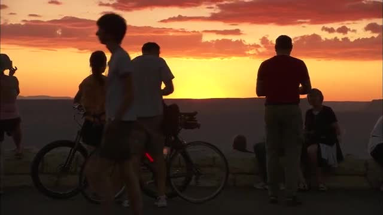

# Real footage: visitors at sunset, Grand Canyon

A short **picture-edit exercise with real, redistributable footage**. Start with three prepared clips, produce a 24-second v1, then make a 22-second v2 while protecting the earlier shots. This shows what the bundled helper can actually do.

**Both previews are intentionally silent.** The original NPS videos contain audio; it is omitted from these exercise copies. This is not a dialogue/music conform, a complete family film or a native editor demonstration.

[](previews/v2.mp4)

[Watch/download v1 — 24 s, silent](previews/v1.mp4) · [Watch/download v2 — 22 s, silent](previews/v2.mp4)

## Try it

Download the source ZIP, extract it and open a terminal or your agent in the extracted repository root. With Python 3.9+, FFmpeg and ffprobe available:

```sh
python3 examples/grand-canyon-sunset/run_demo.py --output "sunset-demo"
```

Or ask your agent:

> Read skills/family-travel-editor/SKILL.md and examples/grand-canyon-sunset/README.md. Check the tools, run the supplied exercise into a new separate folder, explain v1 versus v2 and show me the actual files. Do not claim this silent picture exercise edits speech or a native editor project.

Expect `catalog.json`, `v1.mp4`, `v2.mp4`, video-only `v1.xml` / `v2.xml`, and `verification.json` in the new folder, together with copied plans/feedback/preferences and a generated `STATUS.md` for resuming. The command refuses an existing output folder. It makes no downloads and does not change the included clips. Pass `--ffmpeg PATH --ffprobe PATH` if those executables are outside PATH. Missing tools produce an explanation before creating the output folder.

The self-contained plugin/installed skill does not include this repository example. Use the **source ZIP** to run it.

To run from another directory, use the absolute script path and output path (replace these example paths with your own):

```sh
python3 "/path/to/extracted/family-travel-editor/examples/grand-canyon-sunset/run_demo.py" --output "/path/to/new/sunset-demo"
```

In a fresh chat, ask the agent to read the installed SKILL.md and the generated `sunset-demo/STATUS.md`. Keep the extracted source folder in place: the XML files refer to its media by absolute path. If you move it, regenerate XML with the new media root or relink in your editor.

## Why these shots

| Order | Prepared clip | v1 source range at 25 fps, OUT exclusive | Purpose |
|---|---|---|---|
| 1 | visitors-wide.mp4 | 25–175, 1–7 seconds | Orient: visitors gathered at the rim |
| 2 | camera-gesture.mp4 | 25–275, 1–11 seconds | Action: a visitor raises, holds and lowers a camera |
| 3 | sunset-ending.mp4 | 50–250, 2–10 seconds | Ending: the sun reaches the rim |

The original NPS videos show different viewpoints. This is a thematic sequence, not evidence of one shared evening, a relationship between visitors or the author's own trip. The selection comes from frame inspection; it does not establish the meaning of any source speech.

The supplied [scene plan](scene.json) separates observations and unknowns. The files called v1.json/v2.json are technical shot plans, not that narrative format.

## One revision

The maintainer's **simulated teaching request** is:

> Remove the first two seconds of the final sunset shot. Preserve the end of the sunset and keep both visitor shots unchanged.

In [v2.json](v2.json), only the final IN changes: 50 → 100 frames. The last OUT remains 250. The first 400 timeline frames retain the same source ranges. Total duration changes from 600 to 550 frames. [Feedback record](feedback.json) · [Saved state and next-session prompt](STATUS.md).

Watch the transition from the camera gesture to the sunset and compare the final hold. Render success is not artistic approval; record your own viewing and listening separately. There is no sound to judge in these helper exports.

## Sources and rights

Footage: **NPS Video: Blum, Wells, and Wang**, Grand Canyon National Park. The official [Grand Canyon B-roll page](https://www.nps.gov/grca/learn/photosmultimedia/b-roll_hd18.htm) identifies these downloadable videos as public domain and prohibits implying NPS endorsement. This independent project is not endorsed by NPS.

- [Sunset Series 1](https://www.nps.gov/media/video/view.htm?id=F8DA8682-155D-451F-671FF82CCFD96A5D): the prepared wide shot comes from source seconds 30–39.
- [Couple with Bicyles Watches Sunset](https://www.nps.gov/media/video/view.htm?id=FB7856E8-155D-451F-6721E62F15A4C7FE): camera gesture from 21–34; ending from 58–70.

[Original URLs, credits and SHA-256](sources.json) · [Prepared-copy ranges and hashes](media-manifest.json).

Source offsets above are nominal seek times on the original frame grid; use the prepared-copy frame numbers for exact exercise cuts. Original downloads are 1280×720 at 24000/1001 fps. The included derivatives are 640×360 at 25 fps, with no playback-speed change and no audio. That normalization makes them compatible with the bundled integer-rate helper; it does not certify native mixed-rate editing. Source material contains its own cuts and camera behavior. The originals are available at the URLs above, and remain unchanged by this exercise.

Use [prepare_sources.py](prepare_sources.py) only if you want to download and regenerate the three copies yourself. It requires internet access and FFmpeg; the ordinary run above does not.
